# Golden Atlas

Golden Atlas is a private visual travel diary with a Supabase backend, a Vite web app, and a native SwiftUI iPhone client. The web app runs as a browser-only design prototype by default and connects to the authenticated Supabase backend when configured (see [Connect the web app to Supabase](#connect-the-web-app-to-supabase)); the iOS client in `ios/GoldenAtlas` always uses the real backend.

## Preview

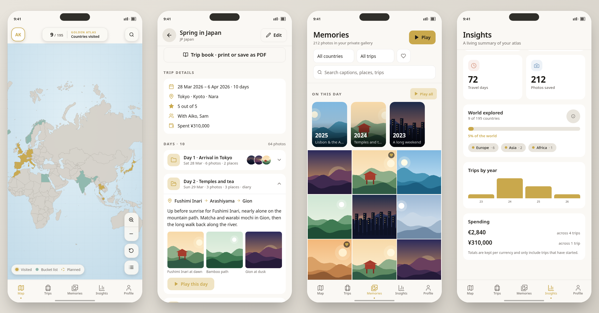

<table>
<tr><td align="center" valign="top">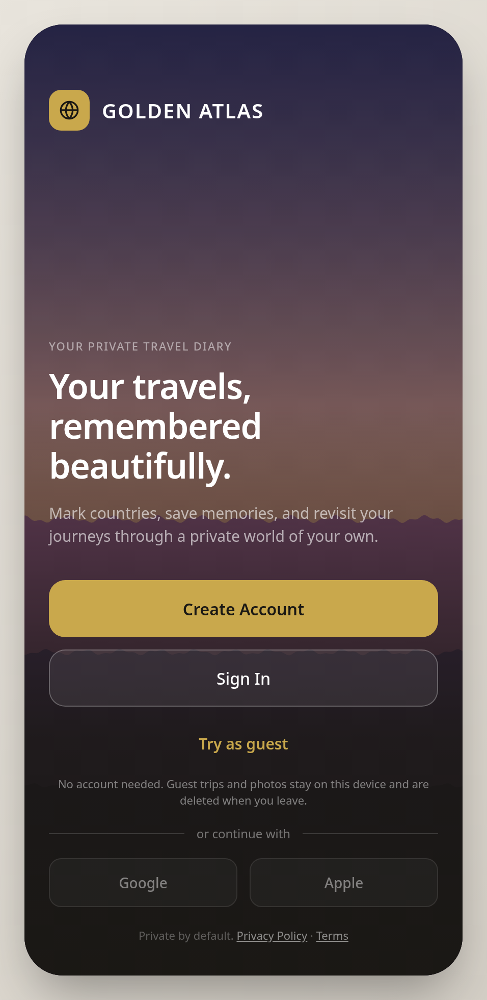<br><sub>Welcome</sub></td><td align="center" valign="top">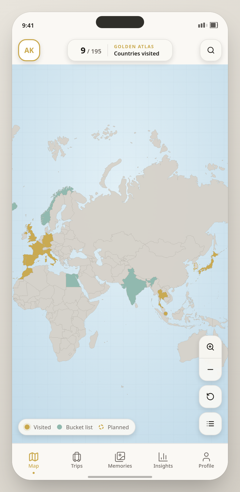<br><sub>World map</sub></td><td align="center" valign="top">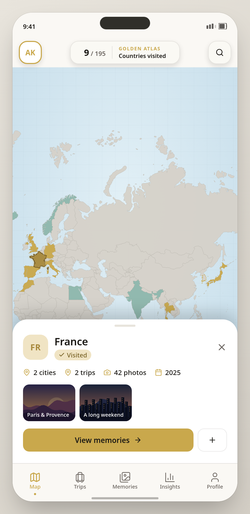<br><sub>Country sheet</sub></td><td align="center" valign="top">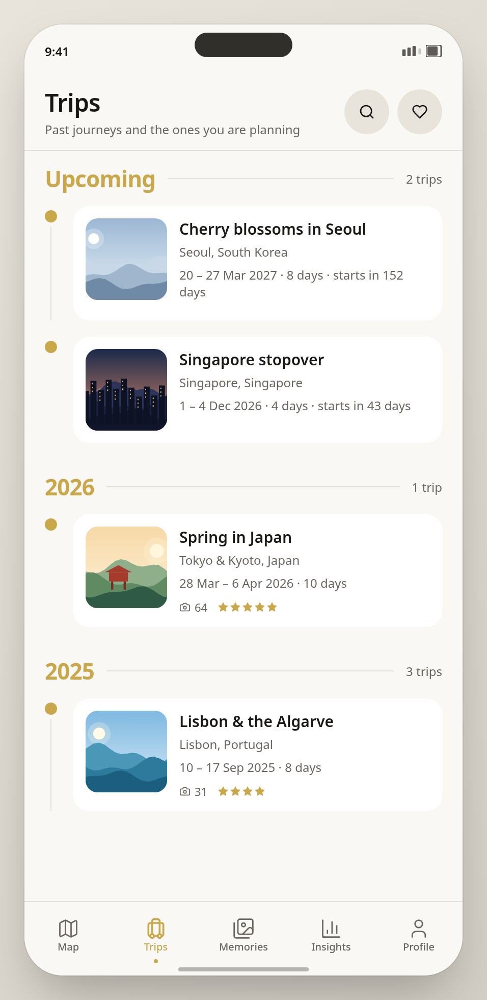<br><sub>Trips and upcoming</sub></td><td align="center" valign="top">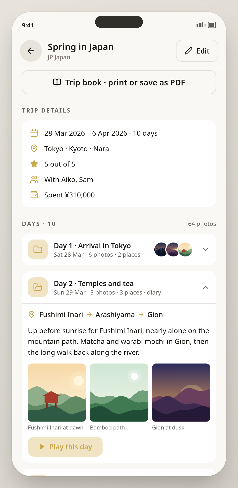<br><sub>Day folders</sub></td></tr>
<tr><td align="center" valign="top">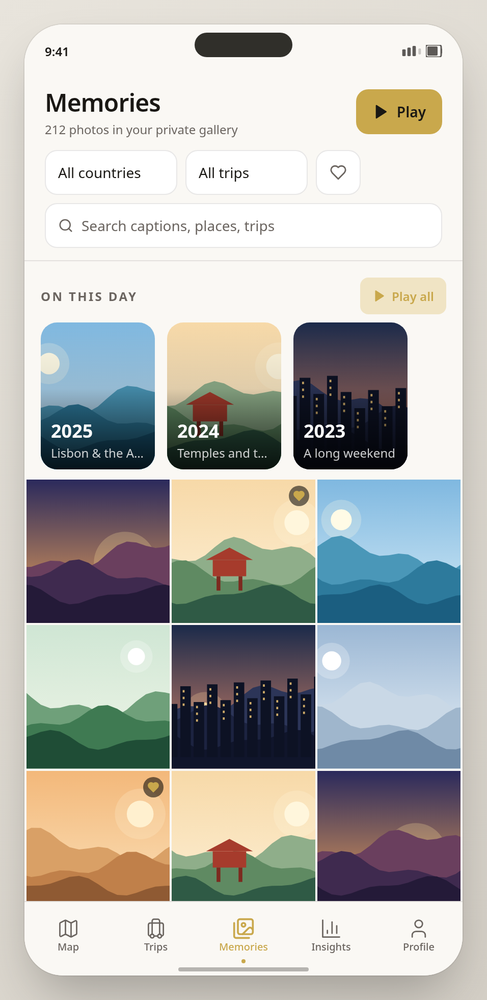<br><sub>Memories</sub></td><td align="center" valign="top">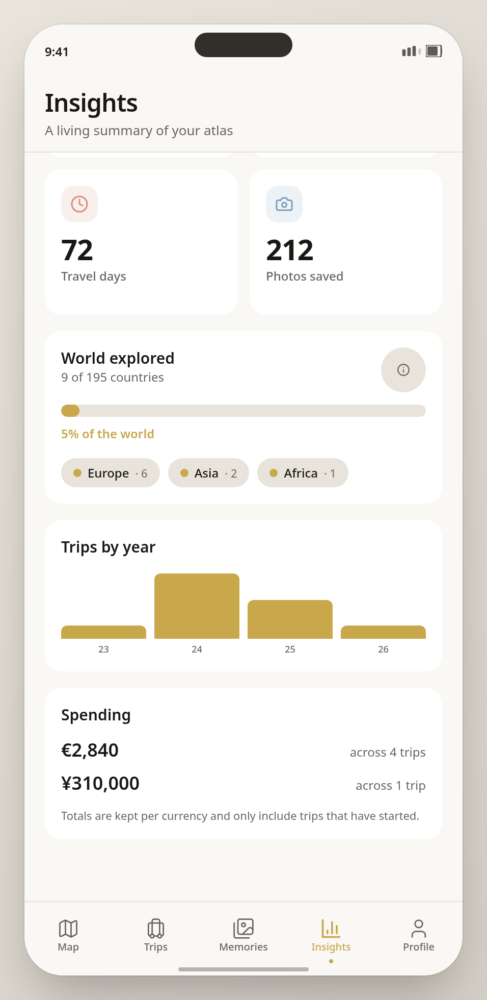<br><sub>Insights</sub></td><td align="center" valign="top">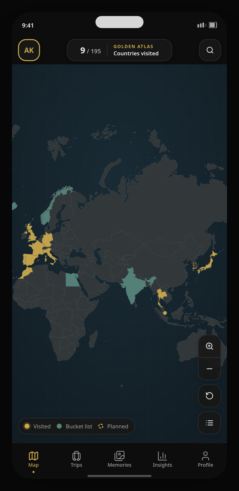<br><sub>Dark mode map</sub></td><td align="center" valign="top">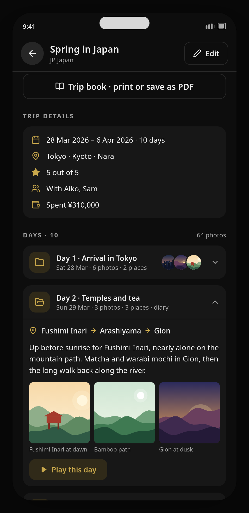<br><sub>Dark mode days</sub></td></tr>
<tr><td align="center" valign="top">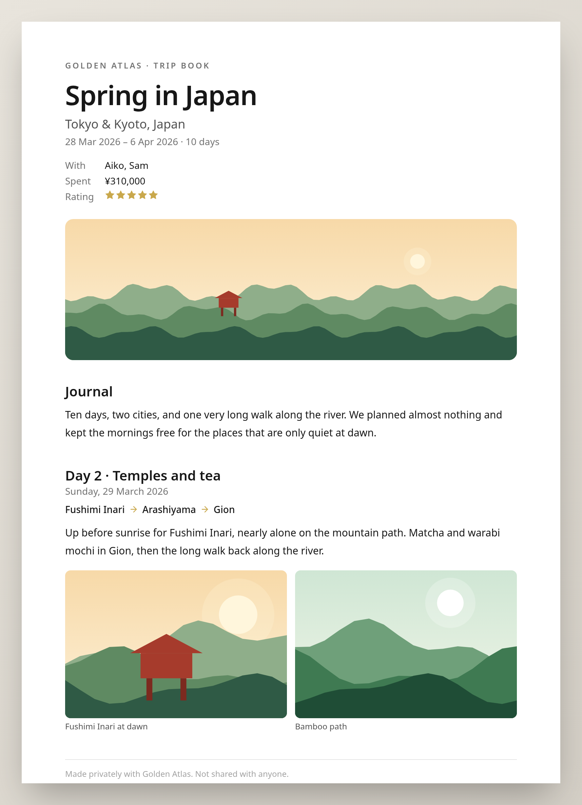<br><sub>Trip book</sub></td></tr>
</table>

> **These are design previews, not screenshots of the running app.** They are rendered from the app's real theme colors, layout and world-map geometry, with sample trips and illustrated stand-in photos (no real photographs or personal data). The map shapes come from the `@svg-maps/world` package (CC BY 4.0). To replace them with true screenshots, run the capture script (see [Refreshing the preview images](#refreshing-the-preview-images)).

## Prerequisites

- Node.js 22 (`nvm use` reads `.nvmrc`)
- pnpm 11.7.0
- Docker Desktop
- Current stable Xcode for the native iOS client

If your shell still reports Node 20 after changing directories, run `nvm use` first. You can also use `./pnpmw` instead of `pnpm`; it selects the pinned Node version from `.nvmrc` when it is installed under nvm.

## Local development

```bash
./pnpmw install --frozen-lockfile
./pnpmw backend:start
./pnpmw dev
```

Supabase Studio is available at `http://127.0.0.1:54323` and captured local verification mail at `http://127.0.0.1:54324`. The web dev server always runs at `http://127.0.0.1:5173` because auth redirects are allow-listed for that exact origin. Never expose the service-role or secret key to a client.

## Connect the web app to Supabase

Without configuration the web app is the browser-only prototype: accounts, trips, and photos live in this browser's IndexedDB and never leave the device. To use the real backend:

```bash
./pnpmw backend:start
cp .env.example .env
./pnpmw exec supabase status   # copy the API URL and the publishable key
# set VITE_SUPABASE_URL and VITE_SUPABASE_PUBLISHABLE_KEY in .env
./pnpmw dev
```

With both variables set, the web app uses email/password auth with required email verification (open the link from the local mailbox at `http://127.0.0.1:54324`), Postgres through row-level security, private storage with ten-minute signed image URLs, and the Edge Functions for memory upload, deletion, and data export. The app refuses to start if the key looks like a service-role or secret key. The prototype-only admin console is disabled in this mode.

**Planning and day folders.** A trip dated in the future is a planned trip: it appears under Upcoming on the Trips tab and in the country sheet, and the country turns gold (and statistics count it) only once the trip starts. Every trip is organised into day folders, one per date, each with its own title, diary (or plan) and photos with editable captions. Photos can be moved between days, and a trip can grow by a day at any time, even outside edit mode. Day diaries are stored in the `trip_days` table and included in data exports.

**More ways to revisit a trip.** Search looks through names, places, companions, journals, every day's diary and photo captions, and shows where the words were found. Memories shows *On this day* from earlier years, any single day can be played as a slideshow, and each day lists the places visited as a route. A trip book page lays a trip out for the browser's print dialog (Save as PDF); it is built locally and never uploaded. Trips can record a total spent (or a budget, while still ahead) and who came along, and any photo can be made the cover.

**Reliability.** Photos upload a few at a time with a progress count and automatic retries; if some still fail the trip is saved and a Retry button keeps the photos in memory until the page is closed. Text you are writing is kept on the device as a draft, so a lost connection or closed tab does not lose it, and an offline banner explains what is happening. Opening the app signs thumbnails first and swaps in full-size images afterwards. Theme, motion, slideshow and privacy settings and the favourite country are stored on the account and follow you to new devices.

**Try as guest** (Welcome screen) starts a passwordless, device-only session in either mode. Guest trips and photos are stored in this browser's IndexedDB, are never sent to Supabase, and are deleted when the guest leaves or the next guest session starts. They cannot be moved into an account.

Known limits of the web integration:

- Photos are decoded and re-encoded in the browser (which removes EXIF/GPS) before upload; only JPEG and PNG inputs are supported.
- The favourite country, theme, slideshow, and privacy toggles are still stored per device. The schema has no column for favourite country yet; adding one needs a new migration and regenerated types.
- Google and Apple sign-in are unavailable until provider credentials are configured (see [hosted authentication](docs/HOSTED_AUTH.md)).
- Drafts hold text only; photos are asked for again. Failed-upload retries live in memory and are lost if the page is reloaded.

Useful commands:

```bash
./pnpmw backend:reset
./pnpmw backend:test:db
./pnpmw backend:test:integration
./pnpmw backend:types
./pnpmw backend:types:swift
./pnpmw backend:verify
./pnpmw backend:stop
```

Create and inspect migrations/functions with the pinned CLI:

```bash
./pnpmw exec supabase migration new descriptive_name
./pnpmw exec supabase migration list --local
./pnpmw exec supabase functions new --auth user function-name
./pnpmw exec supabase functions serve
./pnpmw exec supabase db advisors --local --type all --level warn --fail-on error
```

`./pnpmw backend:verify` starts the stack, resets and seeds it twice, runs database and API integration tests, checks generated-type drift, runs Supabase advisors, and builds the Vite prototype.

Trusted scheduled operations are `cleanup-expired-exports` and `cleanup-abandoned-uploads`. Invoke them only from a server-side scheduler with the current Supabase `SECRET_KEY` (never a browser/native client). They return `has_more`; call again until it is false. Hosted linking, function deployment, scheduling, SMTP, Google, and Apple credentials are external dashboard/release steps documented below.

## Native iOS development

Open `ios/GoldenAtlas/GoldenAtlas.xcodeproj` after installing Xcode. The `GoldenAtlas-Local` scheme targets the local Supabase stack from an iOS Simulator; `GoldenAtlas-Staging` is for an HTTPS hosted project and connected iPhone. See [the iOS setup guide](ios/GoldenAtlas/README.md) for configuration, signing, and testing.

After staging review, the verified hosted workflow is:

```bash
./pnpmw exec supabase link --project-ref YOUR_PROJECT_REF
./pnpmw exec supabase db push --linked --include-seed --dry-run
./pnpmw exec supabase db push --linked --include-seed
./pnpmw exec supabase functions deploy
./pnpmw exec supabase migration list --linked
./pnpmw exec supabase db advisors --linked --type all --level warn --fail-on error
```

Do not automate production deployment from the verification workflow. Configure hosted Auth URLs/providers, scheduler secret calls, SMTP, backups, and alerts before release.

## Refreshing the preview images

`e2e/tests/screenshots.spec.ts` drives the real app (guest session, generated sample photos) and writes screenshots to `docs/images/app/`. It is skipped unless `CAPTURE=1` is set:

```bash
./pnpmw install --frozen-lockfile
cd e2e && npm install && npx playwright install chromium
CAPTURE=1 npx playwright test screenshots
```

Then point the images in this README at `docs/images/app/` instead of `docs/images/preview/`.

## Documentation

- [Backend architecture](docs/BACKEND_ARCHITECTURE.md)
- [Database model](docs/DATABASE.md)
- [API contracts](docs/API_CONTRACTS.md)
- [Security and threat model](docs/SECURITY.md)
- [Detailed threat model](docs/THREAT_MODEL.md)
- [Privacy and media data flow](docs/PRIVACY_DATA_FLOW.md)
- [Backup and recovery assumptions](docs/BACKUP_RECOVERY.md)
- [Hosted authentication setup](docs/HOSTED_AUTH.md)
- [Manual QA checklist](docs/QA_CHECKLIST.md)

Country and territory reference data is derived from GeoNames under CC BY 4.0; see [data attribution](supabase/data/README.md).
