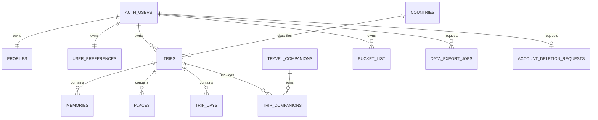

# Database model

| Relation | Purpose | Ownership |
| --- | --- | --- |
| `countries` | GeoNames country/territory reference data | Public read of active rows |
| `profiles` | Display name and future private avatar path | `id = auth.uid()` |
| `user_preferences` | Theme, privacy, analytics, slideshow settings, favourite country | `user_id = auth.uid()` |
| `trips` | Country visit, dates, journal, mood, rating, expenses | `user_id = auth.uid()` |
| `memories` | Photo metadata, generated paths, upload state | User plus owned trip |
| `travel_companions` | User-owned reusable companion records | `user_id = auth.uid()` |
| `trip_companions` | Owned trip-to-owned-companion join | Composite owner FKs |
| `places` | Named place and optional coordinates | User, owned trip, matching country |
| `trip_days` | Optional title and diary (or plan) for one calendar day of a trip | User plus owned trip (composite FK, cascades with the trip) |
| `bucket_list` | Unique user/country wish-list entry | `user_id = auth.uid()` |
| `data_export_jobs` | Private structured-export state and expiry | `user_id = auth.uid()`; server writes only |
| `account_deletion_requests` | Minimum retry state during deletion | `user_id = auth.uid()`; server writes only |
| `personal_statistics` | Trips, countries, continents, days, ready photos | RLS-aware invoker view |

All application identifiers are UUIDs. System timestamps use `timestamptz`; trip dates use `date`. Check constraints cover date order, lengths, ratings, currency shape, coordinate ranges/pairing, MIME types, media sizes, and upload states. Foreign-key access paths and common cursor queries are indexed.

`memories`, `places`, and `trip_companions` use composite foreign keys that include `user_id`. This makes cross-owner relationships invalid even if application code or a policy is later changed incorrectly. Memory ownership, trip identity, MIME identity, and generated object paths are immutable.

Only trusted functions can create/update export and deletion jobs. Authenticated users have `SELECT` on their own job rows so clients can display progress without gaining a write path. One partial unique index permits only one requested/processing export per user. Expiry, user cursor, pending-upload, and deletion-worker indexes support bounded background batches.



## Days and planned trips

A trip's days are implicit: every calendar date from `start_date` to `end_date`. `trip_days` holds a row only for a day the user has written on or listed places for, unique per `(trip_id, day_date)`; `places` is the ordered list of place names visited that day. A photo belongs to a day through its `memories.taken_at` date, so moving a photo to another day only changes that date. Adding a day to a trip extends `end_date`.

A trip whose `start_date` is in the future is a planned trip. It is stored like any other, appears under Upcoming, and is excluded from visited countries and statistics until its first day. Clients compare against the user's local date; the database stores no status.

## Country denominator

The seed contains 250 active ISO-like country and territory rows sourced from GeoNames. `counts_toward_world_total` is true only for the 193 UN members plus the Holy See and State of Palestine. Territories remain searchable/selectable but do not increase the product's 195-country denominator.

The web app shares the same list through `src/app/data/countries.generated.ts`, which the same script writes; a unit test fails if it ever differs from `supabase/seed.sql`. Map shapes without their own row (the Îles Éparses and the US Minor Outlying Islands) resolve to the territory they belong to, and Antarctica has no tappable shape but is available from search, the country list, and the trip form.

Regenerate the deterministic seed after intentionally updating the source file:

```bash
node scripts/generate-country-seed.mjs
pnpm backend:reset
```

## Schema changes

Create every change as a new timestamped migration with the pinned CLI. Do not edit a migration after it has been deployed. Regenerate and commit `src/types/database.generated.ts`, then run `pnpm backend:verify`.
